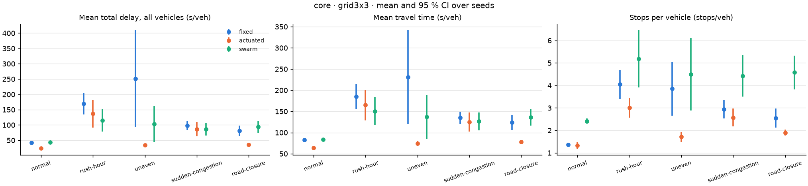
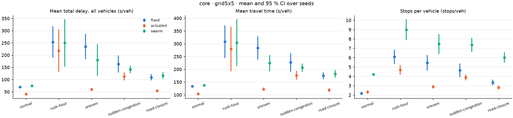
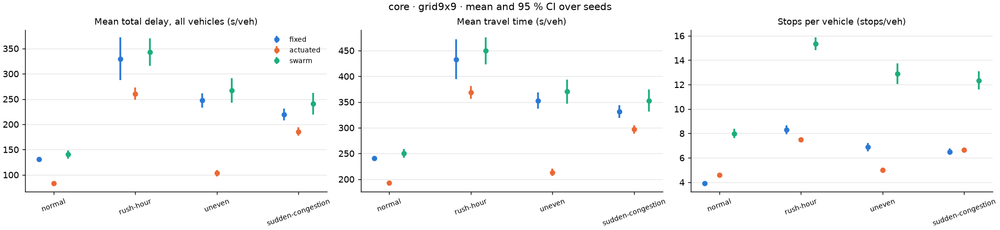
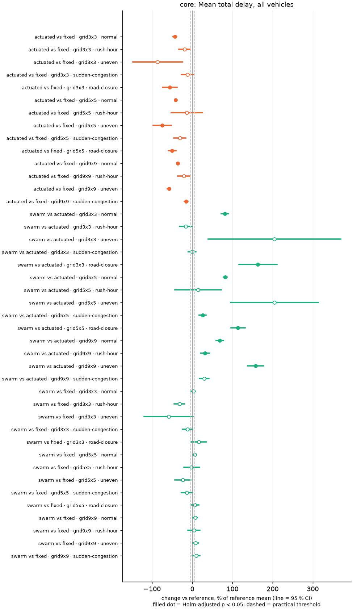

# Evaluation report: eval-v1

Generated 2026-10-13T08:14:14+00:00 by `experiments/tools/analyze_evaluation.py` from raw run artifacts (tripinfo.xml, statistics.xml, per-step time series). No numbers were copied from earlier reports.

> **Preliminary research data.** Results are from SUMO simulations of generated/assumed demand. Statistical significance below means only that the matched difference is unlikely under the null hypothesis *for these simulated scenarios*; it is not proof of real-world benefit, and differences between controllers are associations within this experimental setup.

## Matrix completion

| stage / network | planned cells | completed | failed | cancelled | not run |
|---|---|---|---|---|---|
| core/grid3x3 | 50 | 49 | 1 | 0 | 0 |
| core/grid5x5 | 50 | 49 | 1 | 0 | 0 |
| core/grid9x9 | 50 | 40 | 0 | 10 | 0 |
| ablation/grid5x5 | 50 | 0 | 0 | 0 | 50 |
| emergency/grid5x5 | 20 | 0 | 0 | 0 | 20 |
| mixed/grid5x5_india | 50 | 0 | 0 | 0 | 50 |
| mixed/osm_bengaluru_mg_road | 50 | 0 | 0 | 0 | 50 |

**138 of 320 planned cells completed** (INCOMPLETE - only completed cells are analysed). A cell = one network × scenario × seed, running every controller of its stage on one prepared scenario.

### Failed / cancelled cells

| cell | status | error |
|---|---|---|
| core/grid3x3/road-closure/49 | failed | ValueError: swarm: closure not monitored or violated |
| core/grid5x5/road-closure/44 | failed | ValueError: swarm: closure not monitored or violated |
| core/grid9x9/road-closure/42 | cancelled | stop requested via D:\MyWork\traffic-swarm-intelligence (2)\traffic-swarm-intelligence\traffic-swarm-intelligence\experiments\evaluation\eval-v1\STOP |
| core/grid9x9/road-closure/43 | cancelled | stop requested via D:\MyWork\traffic-swarm-intelligence (2)\traffic-swarm-intelligence\traffic-swarm-intelligence\experiments\evaluation\eval-v1\STOP |
| core/grid9x9/road-closure/44 | cancelled | stop requested via D:\MyWork\traffic-swarm-intelligence (2)\traffic-swarm-intelligence\traffic-swarm-intelligence\experiments\evaluation\eval-v1\STOP |
| core/grid9x9/road-closure/45 | cancelled | stop requested via D:\MyWork\traffic-swarm-intelligence (2)\traffic-swarm-intelligence\traffic-swarm-intelligence\experiments\evaluation\eval-v1\STOP |
| core/grid9x9/road-closure/46 | cancelled | stop requested via D:\MyWork\traffic-swarm-intelligence (2)\traffic-swarm-intelligence\traffic-swarm-intelligence\experiments\evaluation\eval-v1\STOP |
| core/grid9x9/road-closure/47 | cancelled | stop requested via D:\MyWork\traffic-swarm-intelligence (2)\traffic-swarm-intelligence\traffic-swarm-intelligence\experiments\evaluation\eval-v1\STOP |
| core/grid9x9/road-closure/48 | cancelled | stop requested via D:\MyWork\traffic-swarm-intelligence (2)\traffic-swarm-intelligence\traffic-swarm-intelligence\experiments\evaluation\eval-v1\STOP |
| core/grid9x9/road-closure/49 | cancelled | stop requested via D:\MyWork\traffic-swarm-intelligence (2)\traffic-swarm-intelligence\traffic-swarm-intelligence\experiments\evaluation\eval-v1\STOP |
| core/grid9x9/road-closure/50 | cancelled | stop requested via D:\MyWork\traffic-swarm-intelligence (2)\traffic-swarm-intelligence\traffic-swarm-intelligence\experiments\evaluation\eval-v1\STOP |
| core/grid9x9/road-closure/51 | cancelled | stop requested via D:\MyWork\traffic-swarm-intelligence (2)\traffic-swarm-intelligence\traffic-swarm-intelligence\experiments\evaluation\eval-v1\STOP |

### Attempt history

`ledger.jsonl` holds **174 attempts** for 150 cells (append-only; only the latest attempt of a cell counts, earlier artifacts are kept under `superseded/`). Every attempt is listed in `attempts.csv`.

| status | latest attempt | earlier (superseded) attempts |
|---|---|---|
| cancelled | 10 | 0 |
| completed | 138 | 15 |
| failed | 2 | 9 |

Runs that hit the 3600 s cap (`timed_out`): **2**: grid5x5/uneven/45/swarm, grid9x9/rush-hour/43/fixed.
Runs with signal-safety audit violations: **0** (the matrix validator rejects such cells).

## Configuration and software

- Seeds: [42, 43, 44, 45, 46, 47, 48, 49, 50, 51]; demand seed = run seed: True; cap 3600 s.
- Reference controller: `fixed`; practical-relevance threshold: 5.0 % relative change.
- Simulation software (from run metadata): SUMO 1.27.1, traci 1.27.1, netconvert Eclipse SUMO netconvert 1.27.1, Python 3.12.0, Windows-11-10.0.26300-SP0.
- TSI code version of the analysed runs, per stage: core: 1.3.0-features, 1.3.1-eval (see `tsi_version` in runs.csv).
- Analysis: Python 3.12.0, numpy 2.5.4, scipy 1.18.1, matplotlib 3.11.2.
- Controller settings: `{"decision_interval_s": 5, "min_green_s": 10, "max_green_s": 60, "max_red_s": 120, "min_yellow_s": 3, "pedestrian_min_green_s": 15, "observation_ttl_s": 30, "downstream_discount": 0.8, "green_wave_cap_s": 45, "max_consecutive_optimizer_failures": 3, "max_risk": 1.0}`
- Stage **core**: Three-controller comparison on generated grids, all scenarios (road-closure = real SUMO closingReroute). Networks ['grid3x3', 'grid5x5', 'grid9x9'], scenarios ['normal', 'rush-hour', 'uneven', 'sudden-congestion', 'road-closure'], controllers ['fixed', 'actuated', 'swarm'].
- Stage **ablation**: Swarm module ablations (the safety gate is never disabled). Networks ['grid5x5'], scenarios ['normal', 'rush-hour', 'uneven', 'sudden-congestion', 'road-closure'], controllers ['swarm', 'swarm_no_blackboard', 'swarm_no_pheromone', 'swarm_prediction'].
- Stage **emergency**: Ambulance priority vs the same controller without priority (3 ambulances per run). Networks ['grid5x5'], scenarios ['normal', 'rush-hour'], controllers ['fixed', 'fixed_priority', 'swarm', 'swarm_priority'], 3 ambulances.
- Stage **mixed**: Indian mixed traffic (assumed mix) on a left-hand 5x5 grid with pedestrians, and the Bengaluru OSM sample. Networks ['grid5x5_india', 'osm_bengaluru_mg_road'], scenarios ['normal', 'rush-hour', 'uneven', 'sudden-congestion', 'road-closure'], controllers ['fixed', 'actuated', 'swarm'].

## Metric definitions

| metric | unit | lower is better | definition |
|---|---|---|---|
| Mean delay (`mean_delay_s`) | s/veh | yes | Mean SUMO tripinfo timeLoss of arrived non-emergency vehicles: time lost versus driving at the desired speed (includes waiting at signals). |
| Mean travel time (`mean_travel_time_s`) | s/veh | yes | Mean tripinfo duration (arrival - departure) of arrived non-emergency vehicles. |
| Stops per vehicle (`stops_per_vehicle`) | stops/veh | yes | Mean tripinfo waitingCount of arrived non-emergency vehicles (number of times speed fell below 0.1 m/s). |
| Mean total delay, all vehicles (`mean_total_delay_all_s`) | s/veh | yes | Mean of tripinfo timeLoss + departDelay over ALL non-emergency vehicles that departed, including vehicles still en route at the end (SUMO write-unfinished values, censored at the run end, i.e. a lower bound for them). Same denominator for every controller of a cell; the primary delay metric when arrived counts differ. |
| Mean network queue (demand period) (`mean_queue_veh`) | veh | yes | Mean of the network-wide halting-vehicle count (speed < 0.1 m/s, all lanes, every 1 s step) over the demand period [demand begin, demand end] - the same time window for every controller. |
| Max network queue (`max_queue_veh`) | veh | yes | Maximum over all steps of the run of the network-wide halting-vehicle count. |
| Halted vehicle-hours (`halted_vehicle_hours`) | veh·h | yes | Sum over all steps of the network-wide halting-vehicle count × step length / 3600 (whole run; censored at the cap for timed-out runs). |
| Arrived share (`arrived_share`) | fraction | no | Arrived non-emergency vehicles / loaded non-emergency vehicles. |
| Arrived vehicles (`arrived_vehicles`) | veh | no | Non-emergency vehicles that reached their destination before the end of the run (throughput). |
| Unfinished vehicles (`unfinished_vehicles`) | veh | yes | Vehicles loaded but not arrived when the run ended (still driving, waiting to insert, or removed). |
| Fuel per vehicle (`fuel_g_per_vehicle`) | g/veh | yes | Total fuel from SUMO's default emission model (summed per step for all vehicles) / vehicles observed. Not valid for the mixed-traffic stage (one passenger-car model for all types). |
| CO2 per vehicle (`co2_g_per_vehicle`) | g/veh | yes | As fuel, for CO2. |
| Teleports (`teleports`) | count | yes | SUMO teleports (vehicles removed after being stuck for time-to-teleport): a simulation failure indicator. |
| Decision latency (mean) (`decision_latency_ms`) | ms/tick | yes | Swarm controllers only: wall time of one decision tick for the whole network (observe, optimise every junction, coordinate, gate, apply). |
| Optimizer time per decision (`optimizer_ms`) | ms | yes | Swarm controllers only: mean wall time of one PSO+ACO optimizer call. |
| Simulation runtime (`sim_wall_time_s`) | s | yes | Wall-clock time of the run (SUMO + controller), on the machine and parallel load of the matrix run. |
| Ambulance travel time (`ambulance_travel_time_s`) | s | yes | Mean tripinfo duration of the run's ambulances (emergency stage). |
| Ambulance delay (`ambulance_delay_s`) | s | yes | Mean tripinfo timeLoss of the run's ambulances (emergency stage). |
| Online prediction MAE (`prediction_online_mae`) | veh | yes | swarm_prediction only: mean absolute error of the controller's own one-step-ahead per-phase queue predictions, checked online against the later observation. |
| Online prediction RMSE (`prediction_online_rmse`) | veh | yes | As the MAE, root mean squared error. |
| Prediction fallback share (`prediction_fallback_share`) | fraction | yes | Share of predict calls in which the predictor was not reliable yet (rolling MAE above max_mae, or too few checks), so the controller used the current state. |

Denominators: travel time, `mean_delay_s` and stops per vehicle average over ARRIVED vehicles only. When controllers of a cell leave different numbers of vehicles unfinished, those means are not directly comparable; paired tests flag this (`arrived_mismatch_max_pct` > 1 %, 'CAUTION' in the verdict) and `mean_total_delay_all_s` (all departed vehicles) is the primary delay metric. Queue means use the same demand-period window for every controller.

## Statistical method

Statistics for matched (paired) controller comparisons.

Decision rule for one comparison (controller vs reference, same network/scenario/demand/seed):
  d_i = metric(controller, seed i) - metric(reference, seed i)  for every seed where BOTH runs completed
  - n < 5 pairs                      -> 'insufficient_pairs' (no test)
  - all d_i == 0                     -> 'identical' (no test: the runs produced the same value)
  - Shapiro-Wilk on d (alpha 0.05):  p >= 0.05 -> paired t-test is the primary test
                                     p <  0.05 -> Wilcoxon signed-rank (exact when possible) is primary
  - always also: exact sign-flip permutation test of the mean difference (sensitivity check)
Effect size: Cohen's d_z = mean(d) / sd(d). The 95 % CI of the mean difference is t-based.
Multiple comparisons: Holm-Bonferroni over a family of primary p-values (analyze_evaluation uses one
family per matrix stage: every network x scenario x comparison x metric of that stage).
Choosing the test after a normality pre-test is a pragmatic rule, not an exact procedure; the
permutation p-value is distribution-free and is reported alongside as the sensitivity check.
Shapiro-Wilk has little power at n = 10, so a non-rejection is weak evidence of normality; the
permutation p-value is reported for every comparison for that reason.

Verdict: 'significantly better/worse' requires Holm-adjusted p < 0.05; 'practically relevant' additionally requires |relative change| ≥ 5.0 %.

## Stage core






### grid3x3

Mean ± 95 % CI half-width (n seeds):

| scenario | controller | Mean total delay, all vehicles (s/veh) | Mean travel time (s/veh) | Stops per vehicle (stops/veh) | Mean network queue (demand period) (veh) |
|---|---|---|---|---|---|
| normal | fixed | 41.99 ± 1.89 (n=10) | 82.43 ± 2.56 (n=10) | 1.37 ± 0.09 (n=10) | 27.55 ± 1.15 (n=10) |
| normal | actuated | 23.72 ± 2.59 (n=10) | 64.10 ± 3.17 (n=10) | 1.32 ± 0.16 (n=10) | 9.76 ± 1.62 (n=10) |
| normal | swarm | 42.93 ± 2.45 (n=10) | 83.31 ± 3.01 (n=10) | 2.41 ± 0.12 (n=10) | 22.50 ± 1.47 (n=10) |
| rush-hour | fixed | 169.43 ± 35.19 (n=10) | 185.09 ± 29.09 (n=10) | 4.05 ± 0.65 (n=10) | 99.25 ± 12.94 (n=10) |
| rush-hour | actuated | 137.19 ± 45.37 (n=10) | 164.92 ± 36.37 (n=10) | 3.01 ± 0.44 (n=10) | 90.80 ± 15.37 (n=10) |
| rush-hour | swarm | 115.23 ± 36.74 (n=10) | 150.47 ± 33.18 (n=10) | 5.18 ± 1.28 (n=10) | 66.61 ± 13.55 (n=10) |
| uneven | fixed | 251.37 ± 158.33 (n=10) | 231.26 ± 110.55 (n=10) | 3.85 ± 1.19 (n=10) | 81.54 ± 20.75 (n=10) |
| uneven | actuated | 33.87 ± 5.27 (n=10) | 74.35 ± 6.01 (n=10) | 1.71 ± 0.22 (n=10) | 18.59 ± 3.79 (n=10) |
| uneven | swarm | 103.10 ± 58.95 (n=10) | 137.05 ± 51.83 (n=10) | 4.49 ± 1.61 (n=10) | 43.42 ± 11.04 (n=10) |
| sudden-congestion | fixed | 97.84 ± 14.75 (n=10) | 134.97 ± 14.30 (n=10) | 2.94 ± 0.41 (n=10) | 71.70 ± 8.28 (n=10) |
| sudden-congestion | actuated | 86.40 ± 23.44 (n=10) | 125.16 ± 22.65 (n=10) | 2.57 ± 0.39 (n=10) | 65.52 ± 14.66 (n=10) |
| sudden-congestion | swarm | 86.03 ± 20.78 (n=10) | 126.46 ± 20.92 (n=10) | 4.43 ± 0.92 (n=10) | 52.98 ± 10.33 (n=10) |
| road-closure | fixed | 81.09 ± 17.08 (n=9) | 123.91 ± 17.96 (n=9) | 2.55 ± 0.43 (n=9) | 43.75 ± 6.54 (n=9) |
| road-closure | actuated | 35.68 ± 3.09 (n=9) | 77.61 ± 3.82 (n=9) | 1.90 ± 0.14 (n=9) | 16.87 ± 1.84 (n=9) |
| road-closure | swarm | 94.00 ± 18.80 (n=9) | 136.54 ± 19.71 (n=9) | 4.58 ± 0.75 (n=9) | 40.45 ± 6.35 (n=9) |

Paired comparisons (matched seeds):

| scenario | metric | comparison | pairs | mean diff [95 % CI] | change | test (normality p) | p raw | p Holm | d_z | verdict |
|---|---|---|---|---|---|---|---|---|---|---|
| normal | Mean total delay, all vehicles | actuated vs fixed | 10 | -18.27 [-20.07, -16.48] | -43.5 % | paired_t (0.266) | 0.0000 | 0.0000 | -7.30 | significantly better, practically relevant |
| normal | Mean travel time | actuated vs fixed | 10 | -18.33 [-20.14, -16.53] | -22.2 % | paired_t (0.260) | 0.0000 | 0.0000 | -7.26 | significantly better, practically relevant |
| normal | Stops per vehicle | actuated vs fixed | 10 | -0.04 [-0.15, 0.06] | -3.3 % | paired_t (0.104) | 0.3541 | 1.0000 | -0.31 | no significant difference |
| normal | Mean network queue (demand period) | actuated vs fixed | 10 | -17.79 [-19.02, -16.56] | -64.6 % | paired_t (0.213) | 0.0000 | 0.0000 | -10.34 | significantly better, practically relevant |
| normal | Arrived vehicles | actuated vs fixed | 10 | 0.00 [0.00, 0.00] | 0.0 % | identical (—) | 1.0000 | — | 0.00 | identical results |
| normal | Mean total delay, all vehicles | swarm vs fixed | 10 | 0.94 [-1.07, 2.96] | 2.2 % | paired_t (0.166) | 0.3171 | 1.0000 | 0.33 | no significant difference |
| normal | Mean travel time | swarm vs fixed | 10 | 0.88 [-1.13, 2.89] | 1.1 % | paired_t (0.164) | 0.3468 | 1.0000 | 0.31 | no significant difference |
| normal | Stops per vehicle | swarm vs fixed | 10 | 1.05 [0.96, 1.13] | 76.6 % | paired_t (0.369) | 0.0000 | 0.0000 | 9.05 | significantly worse, practically relevant |
| normal | Mean network queue (demand period) | swarm vs fixed | 10 | -5.06 [-6.31, -3.80] | -18.3 % | paired_t (0.095) | 0.0000 | 0.0020 | -2.88 | significantly better, practically relevant |
| normal | Arrived vehicles | swarm vs fixed | 10 | 0.00 [0.00, 0.00] | 0.0 % | identical (—) | 1.0000 | — | 0.00 | identical results |
| normal | Mean total delay, all vehicles | swarm vs actuated | 10 | 19.22 [17.02, 21.42] | 81.0 % | paired_t (0.895) | 0.0000 | 0.0000 | 6.25 | significantly worse, practically relevant |
| normal | Mean travel time | swarm vs actuated | 10 | 19.21 [17.01, 21.42] | 30.0 % | paired_t (0.901) | 0.0000 | 0.0000 | 6.24 | significantly worse, practically relevant |
| normal | Stops per vehicle | swarm vs actuated | 10 | 1.09 [0.98, 1.20] | 82.6 % | paired_t (0.162) | 0.0000 | 0.0000 | 7.31 | significantly worse, practically relevant |
| normal | Mean network queue (demand period) | swarm vs actuated | 10 | 12.74 [11.34, 14.13] | 130.5 % | paired_t (0.813) | 0.0000 | 0.0000 | 6.54 | significantly worse, practically relevant |
| normal | Arrived vehicles | swarm vs actuated | 10 | 0.00 [0.00, 0.00] | 0.0 % | identical (—) | 1.0000 | — | 0.00 | identical results |
| rush-hour | Mean total delay, all vehicles | actuated vs fixed | 10 | -32.24 [-56.34, -8.13] | -19.0 % | paired_t (0.990) | 0.0144 | 1.0000 | -0.96 | no significant difference |
| rush-hour | Mean travel time | actuated vs fixed | 10 | -20.17 [-46.12, 5.78] | -10.9 % | paired_t (0.721) | 0.1126 | 1.0000 | -0.56 | no significant difference |
| rush-hour | Stops per vehicle | actuated vs fixed | 10 | -1.04 [-1.51, -0.58] | -25.7 % | paired_t (0.465) | 0.0007 | 0.1303 | -1.60 | no significant difference |
| rush-hour | Mean network queue (demand period) | actuated vs fixed | 10 | -8.45 [-16.93, 0.03] | -8.5 % | paired_t (0.914) | 0.0507 | 1.0000 | -0.71 | no significant difference |
| rush-hour | Arrived vehicles | actuated vs fixed | 10 | 0.00 [0.00, 0.00] | 0.0 % | identical (—) | 1.0000 | — | 0.00 | identical results |
| rush-hour | Mean total delay, all vehicles | swarm vs fixed | 10 | -54.20 [-75.94, -32.46] | -32.0 % | paired_t (0.514) | 0.0003 | 0.0638 | -1.78 | no significant difference |
| rush-hour | Mean travel time | swarm vs fixed | 10 | -34.61 [-58.47, -10.76] | -18.7 % | paired_t (0.395) | 0.0095 | 1.0000 | -1.04 | no significant difference |
| rush-hour | Stops per vehicle | swarm vs fixed | 10 | 1.13 [0.23, 2.04] | 28.0 % | paired_t (0.769) | 0.0195 | 1.0000 | 0.90 | no significant difference |
| rush-hour | Mean network queue (demand period) | swarm vs fixed | 10 | -32.64 [-41.54, -23.75] | -32.9 % | paired_t (0.367) | 0.0000 | 0.0042 | -2.62 | significantly better, practically relevant |
| rush-hour | Arrived vehicles | swarm vs fixed | 10 | 0.00 [0.00, 0.00] | 0.0 % | identical (—) | 1.0000 | — | 0.00 | identical results |
| rush-hour | Mean total delay, all vehicles | swarm vs actuated | 10 | -21.96 [-43.27, -0.66] | -16.0 % | wilcoxon_signed_rank (0.009) | 0.0059 | 0.7266 | -0.74 | no significant difference |
| rush-hour | Mean travel time | swarm vs actuated | 10 | -14.44 [-30.72, 1.83] | -8.8 % | paired_t (0.305) | 0.0756 | 1.0000 | -0.64 | no significant difference |
| rush-hour | Stops per vehicle | swarm vs actuated | 10 | 2.18 [1.29, 3.06] | 72.4 % | paired_t (0.595) | 0.0004 | 0.0718 | 1.75 | no significant difference |
| rush-hour | Mean network queue (demand period) | swarm vs actuated | 10 | -24.19 [-31.01, -17.38] | -26.6 % | paired_t (0.496) | 0.0000 | 0.0053 | -2.54 | significantly better, practically relevant |
| rush-hour | Arrived vehicles | swarm vs actuated | 10 | 0.00 [0.00, 0.00] | 0.0 % | identical (—) | 1.0000 | — | 0.00 | identical results |
| uneven | Mean total delay, all vehicles | actuated vs fixed | 10 | -217.50 [-372.76, -62.23] | -86.5 % | wilcoxon_signed_rank (0.006) | 0.0020 | 0.3359 | -1.00 | no significant difference |
| uneven | Mean travel time | actuated vs fixed | 10 | -156.91 [-263.79, -50.02] | -67.8 % | wilcoxon_signed_rank (0.013) | 0.0020 | 0.3359 | -1.05 | no significant difference |
| uneven | Stops per vehicle | actuated vs fixed | 10 | -2.14 [-3.14, -1.14] | -55.5 % | paired_t (0.558) | 0.0009 | 0.1743 | -1.53 | no significant difference |
| uneven | Mean network queue (demand period) | actuated vs fixed | 10 | -62.95 [-81.38, -44.52] | -77.2 % | paired_t (0.516) | 0.0000 | 0.0071 | -2.44 | significantly better, practically relevant |
| uneven | Arrived vehicles | actuated vs fixed | 10 | 0.00 [0.00, 0.00] | 0.0 % | identical (—) | 1.0000 | — | 0.00 | identical results |
| uneven | Mean total delay, all vehicles | swarm vs fixed | 10 | -148.27 [-300.51, 3.97] | -59.0 % | wilcoxon_signed_rank (0.002) | 0.0137 | 1.0000 | -0.70 | no significant difference |
| uneven | Mean travel time | swarm vs fixed | 10 | -94.21 [-200.84, 12.42] | -40.7 % | wilcoxon_signed_rank (0.014) | 0.0371 | 1.0000 | -0.63 | no significant difference |
| uneven | Stops per vehicle | swarm vs fixed | 10 | 0.64 [-0.58, 1.85] | 16.6 % | paired_t (0.165) | 0.2646 | 1.0000 | 0.38 | no significant difference |
| uneven | Mean network queue (demand period) | swarm vs fixed | 10 | -38.12 [-55.25, -20.99] | -46.8 % | paired_t (0.254) | 0.0007 | 0.1353 | -1.59 | no significant difference |
| uneven | Arrived vehicles | swarm vs fixed | 10 | 0.00 [0.00, 0.00] | 0.0 % | identical (—) | 1.0000 | — | 0.00 | identical results |
| uneven | Mean total delay, all vehicles | swarm vs actuated | 10 | 69.22 [13.32, 125.13] | 204.4 % | wilcoxon_signed_rank (0.000) | 0.0020 | 0.3359 | 0.89 | no significant difference |
| uneven | Mean travel time | swarm vs actuated | 10 | 62.70 [14.45, 110.95] | 84.3 % | wilcoxon_signed_rank (0.000) | 0.0020 | 0.3359 | 0.93 | no significant difference |
| uneven | Stops per vehicle | swarm vs actuated | 10 | 2.78 [1.30, 4.25] | 162.0 % | wilcoxon_signed_rank (0.002) | 0.0020 | 0.3359 | 1.35 | no significant difference |
| uneven | Mean network queue (demand period) | swarm vs actuated | 10 | 24.83 [16.23, 33.43] | 133.6 % | wilcoxon_signed_rank (0.012) | 0.0020 | 0.3359 | 2.07 | no significant difference |
| uneven | Arrived vehicles | swarm vs actuated | 10 | 0.00 [0.00, 0.00] | 0.0 % | identical (—) | 1.0000 | — | 0.00 | identical results |
| sudden-congestion | Mean total delay, all vehicles | actuated vs fixed | 10 | -11.44 [-26.63, 3.75] | -11.7 % | wilcoxon_signed_rank (0.001) | 0.0840 | 1.0000 | -0.54 | no significant difference |
| sudden-congestion | Mean travel time | actuated vs fixed | 10 | -9.81 [-24.81, 5.19] | -7.3 % | wilcoxon_signed_rank (0.004) | 0.1055 | 1.0000 | -0.47 | no significant difference |
| sudden-congestion | Stops per vehicle | actuated vs fixed | 10 | -0.37 [-0.62, -0.13] | -12.7 % | paired_t (0.433) | 0.0069 | 0.8463 | -1.10 | no significant difference |
| sudden-congestion | Mean network queue (demand period) | actuated vs fixed | 10 | -6.19 [-15.25, 2.88] | -8.6 % | paired_t (0.174) | 0.1572 | 1.0000 | -0.49 | no significant difference |
| sudden-congestion | Arrived vehicles | actuated vs fixed | 10 | 0.00 [0.00, 0.00] | 0.0 % | identical (—) | 1.0000 | — | 0.00 | identical results |
| sudden-congestion | Mean total delay, all vehicles | swarm vs fixed | 10 | -11.81 [-24.21, 0.59] | -12.1 % | wilcoxon_signed_rank (0.025) | 0.0840 | 1.0000 | -0.68 | no significant difference |
| sudden-congestion | Mean travel time | swarm vs fixed | 10 | -8.51 [-21.23, 4.21] | -6.3 % | wilcoxon_signed_rank (0.036) | 0.1055 | 1.0000 | -0.48 | no significant difference |
| sudden-congestion | Stops per vehicle | swarm vs fixed | 10 | 1.48 [0.85, 2.11] | 50.3 % | wilcoxon_signed_rank (0.013) | 0.0020 | 0.3359 | 1.68 | no significant difference |
| sudden-congestion | Mean network queue (demand period) | swarm vs fixed | 10 | -18.72 [-24.82, -12.61] | -26.1 % | paired_t (0.126) | 0.0001 | 0.0151 | -2.19 | significantly better, practically relevant |
| sudden-congestion | Arrived vehicles | swarm vs fixed | 10 | 0.00 [0.00, 0.00] | 0.0 % | identical (—) | 1.0000 | — | 0.00 | identical results |
| sudden-congestion | Mean total delay, all vehicles | swarm vs actuated | 10 | -0.37 [-8.26, 7.51] | -0.4 % | paired_t (0.856) | 0.9171 | 1.0000 | -0.03 | no significant difference |
| sudden-congestion | Mean travel time | swarm vs actuated | 10 | 1.30 [-6.57, 9.17] | 1.0 % | paired_t (0.890) | 0.7172 | 1.0000 | 0.12 | no significant difference |
| sudden-congestion | Stops per vehicle | swarm vs actuated | 10 | 1.85 [1.28, 2.43] | 72.1 % | paired_t (0.525) | 0.0000 | 0.0103 | 2.32 | significantly worse, practically relevant |
| sudden-congestion | Mean network queue (demand period) | swarm vs actuated | 10 | -12.53 [-19.20, -5.87] | -19.1 % | paired_t (0.561) | 0.0021 | 0.3359 | -1.34 | no significant difference |
| sudden-congestion | Arrived vehicles | swarm vs actuated | 10 | 0.00 [0.00, 0.00] | 0.0 % | identical (—) | 1.0000 | — | 0.00 | identical results |
| road-closure | Mean total delay, all vehicles | actuated vs fixed | 9 | -45.41 [-60.27, -30.54] | -56.0 % | paired_t (0.756) | 0.0001 | 0.0228 | -2.35 | significantly better, practically relevant |
| road-closure | Mean travel time | actuated vs fixed | 9 | -46.30 [-61.41, -31.20] | -37.4 % | paired_t (0.806) | 0.0001 | 0.0224 | -2.36 | significantly better, practically relevant |
| road-closure | Stops per vehicle | actuated vs fixed | 9 | -0.66 [-0.99, -0.33] | -25.7 % | paired_t (0.664) | 0.0018 | 0.3199 | -1.53 | no significant difference |
| road-closure | Mean network queue (demand period) | actuated vs fixed | 9 | -26.88 [-32.41, -21.34] | -61.4 % | paired_t (0.906) | 0.0000 | 0.0010 | -3.73 | significantly better, practically relevant |
| road-closure | Arrived vehicles | actuated vs fixed | 9 | 0.00 [0.00, 0.00] | 0.0 % | identical (—) | 1.0000 | — | 0.00 | identical results |
| road-closure | Mean total delay, all vehicles | swarm vs fixed | 9 | 12.91 [-2.41, 28.24] | 15.9 % | paired_t (0.204) | 0.0878 | 1.0000 | 0.65 | no significant difference |
| road-closure | Mean travel time | swarm vs fixed | 9 | 12.62 [-2.56, 27.81] | 10.2 % | paired_t (0.144) | 0.0916 | 1.0000 | 0.64 | no significant difference |
| road-closure | Stops per vehicle | swarm vs fixed | 9 | 2.02 [1.44, 2.60] | 79.1 % | paired_t (0.762) | 0.0000 | 0.0097 | 2.69 | significantly worse, practically relevant |
| road-closure | Mean network queue (demand period) | swarm vs fixed | 9 | -3.29 [-8.02, 1.43] | -7.5 % | paired_t (0.550) | 0.1466 | 1.0000 | -0.54 | no significant difference |
| road-closure | Arrived vehicles | swarm vs fixed | 9 | 0.00 [0.00, 0.00] | 0.0 % | identical (—) | 1.0000 | — | 0.00 | identical results |
| road-closure | Mean total delay, all vehicles | swarm vs actuated | 9 | 58.32 [41.52, 75.12] | 163.5 % | paired_t (0.193) | 0.0000 | 0.0101 | 2.67 | significantly worse, practically relevant |
| road-closure | Mean travel time | swarm vs actuated | 9 | 58.93 [41.60, 76.26] | 75.9 % | paired_t (0.213) | 0.0001 | 0.0114 | 2.61 | significantly worse, practically relevant |
| road-closure | Stops per vehicle | swarm vs actuated | 9 | 2.68 [2.01, 3.35] | 141.1 % | paired_t (0.607) | 0.0000 | 0.0040 | 3.07 | significantly worse, practically relevant |
| road-closure | Mean network queue (demand period) | swarm vs actuated | 9 | 23.58 [18.32, 28.85] | 139.8 % | paired_t (0.282) | 0.0000 | 0.0017 | 3.45 | significantly worse, practically relevant |
| road-closure | Arrived vehicles | swarm vs actuated | 9 | 0.00 [0.00, 0.00] | 0.0 % | identical (—) | 1.0000 | — | 0.00 | identical results |

### grid5x5

Mean ± 95 % CI half-width (n seeds):

| scenario | controller | Mean total delay, all vehicles (s/veh) | Mean travel time (s/veh) | Stops per vehicle (stops/veh) | Mean network queue (demand period) (veh) |
|---|---|---|---|---|---|
| normal | fixed | 70.02 ± 3.29 (n=10) | 133.29 ± 3.91 (n=10) | 2.17 ± 0.13 (n=10) | 77.06 ± 2.92 (n=10) |
| normal | actuated | 40.96 ± 2.59 (n=10) | 104.09 ± 3.23 (n=10) | 2.31 ± 0.16 (n=10) | 28.90 ± 2.66 (n=10) |
| normal | swarm | 74.54 ± 1.71 (n=10) | 137.74 ± 2.15 (n=10) | 4.21 ± 0.10 (n=10) | 64.63 ± 1.82 (n=10) |
| rush-hour | fixed | 253.42 ± 64.64 (n=10) | 307.91 ± 63.53 (n=10) | 6.08 ± 0.77 (n=10) | 232.19 ± 17.75 (n=10) |
| rush-hour | actuated | 218.16 ± 86.83 (n=10) | 279.28 ± 87.37 (n=10) | 4.68 ± 0.53 (n=10) | 200.81 ± 20.43 (n=10) |
| rush-hour | swarm | 249.75 ± 97.44 (n=10) | 304.63 ± 91.72 (n=10) | 8.99 ± 1.12 (n=10) | 174.56 ± 14.17 (n=10) |
| uneven | fixed | 234.76 ± 51.99 (n=10) | 283.57 ± 45.22 (n=10) | 5.44 ± 0.83 (n=10) | 175.56 ± 18.31 (n=10) |
| uneven | actuated | 58.90 ± 6.36 (n=10) | 122.28 ± 6.78 (n=10) | 2.89 ± 0.19 (n=10) | 53.78 ± 7.28 (n=10) |
| uneven | swarm | 179.47 ± 65.02 (n=10) | 224.00 ± 32.45 (n=10) | 7.47 ± 1.07 (n=10) | 113.64 ± 10.52 (n=10) |
| sudden-congestion | fixed | 163.45 ± 35.22 (n=10) | 227.17 ± 36.06 (n=10) | 4.64 ± 0.72 (n=10) | 182.57 ± 22.32 (n=10) |
| sudden-congestion | actuated | 112.65 ± 16.57 (n=10) | 176.58 ± 17.62 (n=10) | 3.87 ± 0.33 (n=10) | 137.59 ± 17.68 (n=10) |
| sudden-congestion | swarm | 141.90 ± 15.80 (n=10) | 206.49 ± 16.31 (n=10) | 7.36 ± 0.74 (n=10) | 137.60 ± 10.22 (n=10) |
| road-closure | fixed | 109.17 ± 13.19 (n=9) | 174.86 ± 13.40 (n=9) | 3.33 ± 0.30 (n=9) | 100.52 ± 5.78 (n=9) |
| road-closure | actuated | 54.42 ± 5.91 (n=9) | 118.95 ± 6.55 (n=9) | 2.81 ± 0.22 (n=9) | 41.33 ± 5.69 (n=9) |
| road-closure | swarm | 116.32 ± 13.91 (n=9) | 182.29 ± 14.68 (n=9) | 6.01 ± 0.57 (n=9) | 86.03 ± 7.94 (n=9) |

Paired comparisons (matched seeds):

| scenario | metric | comparison | pairs | mean diff [95 % CI] | change | test (normality p) | p raw | p Holm | d_z | verdict |
|---|---|---|---|---|---|---|---|---|---|---|
| normal | Mean total delay, all vehicles | actuated vs fixed | 10 | -29.06 [-31.00, -27.12] | -41.5 % | paired_t (0.190) | 0.0000 | 0.0000 | -10.70 | significantly better, practically relevant |
| normal | Mean travel time | actuated vs fixed | 10 | -29.20 [-31.19, -27.21] | -21.9 % | paired_t (0.127) | 0.0000 | 0.0000 | -10.48 | significantly better, practically relevant |
| normal | Stops per vehicle | actuated vs fixed | 10 | 0.14 [0.04, 0.25] | 6.6 % | paired_t (0.235) | 0.0128 | 1.0000 | 0.98 | no significant difference |
| normal | Mean network queue (demand period) | actuated vs fixed | 10 | -48.17 [-50.03, -46.30] | -62.5 % | paired_t (0.711) | 0.0000 | 0.0000 | -18.49 | significantly better, practically relevant |
| normal | Arrived vehicles | actuated vs fixed | 10 | 0.00 [0.00, 0.00] | 0.0 % | identical (—) | 1.0000 | — | 0.00 | identical results |
| normal | Mean total delay, all vehicles | swarm vs fixed | 10 | 4.52 [1.93, 7.10] | 6.5 % | paired_t (0.500) | 0.0033 | 0.4319 | 1.25 | no significant difference |
| normal | Mean travel time | swarm vs fixed | 10 | 4.46 [1.81, 7.10] | 3.3 % | paired_t (0.539) | 0.0042 | 0.5270 | 1.20 | no significant difference |
| normal | Stops per vehicle | swarm vs fixed | 10 | 2.05 [1.97, 2.12] | 94.4 % | paired_t (0.890) | 0.0000 | 0.0000 | 19.09 | significantly worse, practically relevant |
| normal | Mean network queue (demand period) | swarm vs fixed | 10 | -12.43 [-15.04, -9.83] | -16.1 % | paired_t (0.604) | 0.0000 | 0.0005 | -3.42 | significantly better, practically relevant |
| normal | Arrived vehicles | swarm vs fixed | 10 | 0.00 [0.00, 0.00] | 0.0 % | identical (—) | 1.0000 | — | 0.00 | identical results |
| normal | Mean total delay, all vehicles | swarm vs actuated | 10 | 33.58 [31.59, 35.57] | 82.0 % | paired_t (0.115) | 0.0000 | 0.0000 | 12.08 | significantly worse, practically relevant |
| normal | Mean travel time | swarm vs actuated | 10 | 33.66 [31.69, 35.63] | 32.3 % | paired_t (0.098) | 0.0000 | 0.0000 | 12.22 | significantly worse, practically relevant |
| normal | Stops per vehicle | swarm vs actuated | 10 | 1.90 [1.78, 2.02] | 82.3 % | paired_t (0.575) | 0.0000 | 0.0000 | 11.29 | significantly worse, practically relevant |
| normal | Mean network queue (demand period) | swarm vs actuated | 10 | 35.73 [33.24, 38.22] | 123.6 % | paired_t (0.220) | 0.0000 | 0.0000 | 10.26 | significantly worse, practically relevant |
| normal | Arrived vehicles | swarm vs actuated | 10 | 0.00 [0.00, 0.00] | 0.0 % | identical (—) | 1.0000 | — | 0.00 | identical results |
| rush-hour | Mean total delay, all vehicles | actuated vs fixed | 10 | -35.26 [-133.54, 63.02] | -13.9 % | paired_t (0.363) | 0.4380 | 1.0000 | -0.26 | no significant difference |
| rush-hour | Mean travel time | actuated vs fixed | 10 | -28.63 [-127.06, 69.80] | -9.3 % | paired_t (0.285) | 0.5270 | 1.0000 | -0.21 | no significant difference |
| rush-hour | Stops per vehicle | actuated vs fixed | 10 | -1.40 [-1.99, -0.81] | -23.1 % | paired_t (0.056) | 0.0004 | 0.0877 | -1.70 | no significant difference |
| rush-hour | Mean network queue (demand period) | actuated vs fixed | 10 | -31.38 [-47.78, -14.98] | -13.5 % | paired_t (0.645) | 0.0019 | 0.3325 | -1.37 | no significant difference |
| rush-hour | Arrived vehicles | actuated vs fixed | 10 | 0.00 [0.00, 0.00] | 0.0 % | identical (—) | 1.0000 | — | 0.00 | identical results |
| rush-hour | Mean total delay, all vehicles | swarm vs fixed | 10 | -3.67 [-51.85, 44.51] | -1.4 % | paired_t (0.946) | 0.8670 | 1.0000 | -0.05 | no significant difference |
| rush-hour | Mean travel time | swarm vs fixed | 10 | -3.28 [-45.19, 38.64] | -1.1 % | paired_t (0.968) | 0.8635 | 1.0000 | -0.06 | no significant difference |
| rush-hour | Stops per vehicle | swarm vs fixed | 10 | 2.91 [2.10, 3.72] | 47.8 % | paired_t (0.824) | 0.0000 | 0.0049 | 2.57 | significantly worse, practically relevant |
| rush-hour | Mean network queue (demand period) | swarm vs fixed | 10 | -57.63 [-68.21, -47.04] | -24.8 % | paired_t (0.624) | 0.0000 | 0.0002 | -3.90 | significantly better, practically relevant |
| rush-hour | Arrived vehicles | swarm vs fixed | 10 | 0.00 [0.00, 0.00] | 0.0 % | identical (—) | 1.0000 | — | 0.00 | identical results |
| rush-hour | Mean total delay, all vehicles | swarm vs actuated | 10 | 31.59 [-94.37, 157.55] | 14.5 % | paired_t (0.379) | 0.5843 | 1.0000 | 0.18 | no significant difference |
| rush-hour | Mean travel time | swarm vs actuated | 10 | 25.35 [-96.48, 147.18] | 9.1 % | paired_t (0.506) | 0.6490 | 1.0000 | 0.15 | no significant difference |
| rush-hour | Stops per vehicle | swarm vs actuated | 10 | 4.31 [3.32, 5.31] | 92.1 % | paired_t (0.604) | 0.0000 | 0.0011 | 3.10 | significantly worse, practically relevant |
| rush-hour | Mean network queue (demand period) | swarm vs actuated | 10 | -26.25 [-45.18, -7.31] | -13.1 % | wilcoxon_signed_rank (0.050) | 0.0039 | 0.5000 | -0.99 | no significant difference |
| rush-hour | Arrived vehicles | swarm vs actuated | 10 | 0.00 [0.00, 0.00] | 0.0 % | identical (—) | 1.0000 | — | 0.00 | identical results |
| uneven | Mean total delay, all vehicles | actuated vs fixed | 10 | -175.86 [-227.83, -123.89] | -74.9 % | paired_t (0.150) | 0.0000 | 0.0076 | -2.42 | significantly better, practically relevant |
| uneven | Mean travel time | actuated vs fixed | 10 | -161.28 [-206.09, -116.47] | -56.9 % | paired_t (0.073) | 0.0000 | 0.0049 | -2.57 | significantly better, practically relevant |
| uneven | Stops per vehicle | actuated vs fixed | 10 | -2.55 [-3.34, -1.76] | -46.9 % | paired_t (0.082) | 0.0000 | 0.0104 | -2.31 | significantly better, practically relevant |
| uneven | Mean network queue (demand period) | actuated vs fixed | 10 | -121.78 [-140.79, -102.78] | -69.4 % | paired_t (0.098) | 0.0000 | 0.0000 | -4.58 | significantly better, practically relevant |
| uneven | Arrived vehicles | actuated vs fixed | 10 | 0.00 [0.00, 0.00] | 0.0 % | identical (—) | 1.0000 | — | 0.00 | identical results |
| uneven | Mean total delay, all vehicles | swarm vs fixed | 10 | -55.29 [-101.16, -9.42] | -23.6 % | paired_t (0.792) | 0.0233 | 1.0000 | -0.86 | no significant difference |
| uneven | Mean travel time | swarm vs fixed | 10 | -59.56 [-87.97, -31.16] | -21.0 % | paired_t (0.856) | 0.0011 | 0.1929 | -1.50 | no significant difference; CAUTION arrived counts differ by up to 7.4 % (compare all-vehicle delay) |
| uneven | Stops per vehicle | swarm vs fixed | 10 | 2.02 [1.30, 2.75] | 37.2 % | paired_t (0.072) | 0.0001 | 0.0284 | 2.00 | significantly worse, practically relevant; CAUTION arrived counts differ by up to 7.4 % (compare all-vehicle delay) |
| uneven | Mean network queue (demand period) | swarm vs fixed | 10 | -61.92 [-74.15, -49.69] | -35.3 % | wilcoxon_signed_rank (0.002) | 0.0020 | 0.3359 | -3.62 | no significant difference |
| uneven | Arrived vehicles | swarm vs fixed | 10 | -13.40 [-43.71, 16.91] | -0.7 % | wilcoxon_signed_rank (—) | 1.0000 | 1.0000 | -0.32 | no significant difference |
| uneven | Mean total delay, all vehicles | swarm vs actuated | 10 | 120.57 [56.48, 184.66] | 204.7 % | wilcoxon_signed_rank (0.004) | 0.0020 | 0.3359 | 1.35 | no significant difference |
| uneven | Mean travel time | swarm vs actuated | 10 | 101.72 [71.11, 132.32] | 83.2 % | paired_t (0.941) | 0.0000 | 0.0086 | 2.38 | significantly worse, practically relevant; CAUTION arrived counts differ by up to 7.4 % (compare all-vehicle delay) |
| uneven | Stops per vehicle | swarm vs actuated | 10 | 4.57 [3.58, 5.57] | 158.2 % | paired_t (0.745) | 0.0000 | 0.0007 | 3.30 | significantly worse, practically relevant; CAUTION arrived counts differ by up to 7.4 % (compare all-vehicle delay) |
| uneven | Mean network queue (demand period) | swarm vs actuated | 10 | 59.86 [50.05, 69.68] | 111.3 % | paired_t (0.639) | 0.0000 | 0.0001 | 4.36 | significantly worse, practically relevant |
| uneven | Arrived vehicles | swarm vs actuated | 10 | -13.40 [-43.71, 16.91] | -0.7 % | wilcoxon_signed_rank (—) | 1.0000 | 1.0000 | -0.32 | no significant difference |
| sudden-congestion | Mean total delay, all vehicles | actuated vs fixed | 10 | -50.80 [-74.94, -26.66] | -31.1 % | paired_t (0.414) | 0.0010 | 0.1895 | -1.51 | no significant difference |
| sudden-congestion | Mean travel time | actuated vs fixed | 10 | -50.59 [-74.76, -26.42] | -22.3 % | paired_t (0.426) | 0.0011 | 0.1941 | -1.50 | no significant difference |
| sudden-congestion | Stops per vehicle | actuated vs fixed | 10 | -0.77 [-1.24, -0.31] | -16.7 % | paired_t (0.356) | 0.0043 | 0.5337 | -1.20 | no significant difference |
| sudden-congestion | Mean network queue (demand period) | actuated vs fixed | 10 | -44.98 [-58.32, -31.64] | -24.6 % | paired_t (0.226) | 0.0000 | 0.0077 | -2.41 | significantly better, practically relevant |
| sudden-congestion | Arrived vehicles | actuated vs fixed | 10 | 0.00 [0.00, 0.00] | 0.0 % | identical (—) | 1.0000 | — | 0.00 | identical results |
| sudden-congestion | Mean total delay, all vehicles | swarm vs fixed | 10 | -21.55 [-43.96, 0.86] | -13.2 % | paired_t (0.161) | 0.0577 | 1.0000 | -0.69 | no significant difference |
| sudden-congestion | Mean travel time | swarm vs fixed | 10 | -20.68 [-43.12, 1.75] | -9.1 % | paired_t (0.127) | 0.0667 | 1.0000 | -0.66 | no significant difference |
| sudden-congestion | Stops per vehicle | swarm vs fixed | 10 | 2.72 [2.44, 3.00] | 58.6 % | paired_t (0.272) | 0.0000 | 0.0000 | 6.90 | significantly worse, practically relevant |
| sudden-congestion | Mean network queue (demand period) | swarm vs fixed | 10 | -44.97 [-58.59, -31.34] | -24.6 % | paired_t (0.827) | 0.0000 | 0.0090 | -2.36 | significantly better, practically relevant |
| sudden-congestion | Arrived vehicles | swarm vs fixed | 10 | 0.00 [0.00, 0.00] | 0.0 % | identical (—) | 1.0000 | — | 0.00 | identical results |
| sudden-congestion | Mean total delay, all vehicles | swarm vs actuated | 10 | 29.25 [19.64, 38.85] | 26.0 % | paired_t (0.288) | 0.0001 | 0.0158 | 2.18 | significantly worse, practically relevant |
| sudden-congestion | Mean travel time | swarm vs actuated | 10 | 29.91 [20.25, 39.57] | 16.9 % | paired_t (0.136) | 0.0001 | 0.0141 | 2.21 | significantly worse, practically relevant |
| sudden-congestion | Stops per vehicle | swarm vs actuated | 10 | 3.50 [3.03, 3.96] | 90.4 % | wilcoxon_signed_rank (0.019) | 0.0020 | 0.3359 | 5.34 | no significant difference |
| sudden-congestion | Mean network queue (demand period) | swarm vs actuated | 10 | 0.01 [-9.50, 9.52] | 0.0 % | paired_t (0.120) | 0.9984 | 1.0000 | 0.00 | no significant difference |
| sudden-congestion | Arrived vehicles | swarm vs actuated | 10 | 0.00 [0.00, 0.00] | 0.0 % | identical (—) | 1.0000 | — | 0.00 | identical results |
| road-closure | Mean total delay, all vehicles | actuated vs fixed | 9 | -54.75 [-64.77, -44.73] | -50.2 % | paired_t (0.179) | 0.0000 | 0.0004 | -4.20 | significantly better, practically relevant |
| road-closure | Mean travel time | actuated vs fixed | 9 | -55.91 [-66.03, -45.79] | -32.0 % | paired_t (0.201) | 0.0000 | 0.0004 | -4.24 | significantly better, practically relevant |
| road-closure | Stops per vehicle | actuated vs fixed | 9 | -0.52 [-0.77, -0.27] | -15.7 % | paired_t (0.747) | 0.0013 | 0.2306 | -1.61 | no significant difference |
| road-closure | Mean network queue (demand period) | actuated vs fixed | 9 | -59.19 [-63.69, -54.70] | -58.9 % | paired_t (0.606) | 0.0000 | 0.0000 | -10.12 | significantly better, practically relevant |
| road-closure | Arrived vehicles | actuated vs fixed | 9 | 0.00 [0.00, 0.00] | 0.0 % | identical (—) | 1.0000 | — | 0.00 | identical results |
| road-closure | Mean total delay, all vehicles | swarm vs fixed | 9 | 7.15 [-3.24, 17.54] | 6.5 % | paired_t (0.699) | 0.1513 | 1.0000 | 0.53 | no significant difference |
| road-closure | Mean travel time | swarm vs fixed | 9 | 7.43 [-3.68, 18.53] | 4.2 % | paired_t (0.728) | 0.1617 | 1.0000 | 0.51 | no significant difference |
| road-closure | Stops per vehicle | swarm vs fixed | 9 | 2.68 [2.26, 3.11] | 80.6 % | paired_t (0.585) | 0.0000 | 0.0001 | 4.83 | significantly worse, practically relevant |
| road-closure | Mean network queue (demand period) | swarm vs fixed | 9 | -14.49 [-21.21, -7.77] | -14.4 % | paired_t (0.794) | 0.0011 | 0.1973 | -1.66 | no significant difference |
| road-closure | Arrived vehicles | swarm vs fixed | 9 | 0.00 [0.00, 0.00] | 0.0 % | identical (—) | 1.0000 | — | 0.00 | identical results |
| road-closure | Mean total delay, all vehicles | swarm vs actuated | 9 | 61.90 [52.33, 71.46] | 113.7 % | paired_t (0.424) | 0.0000 | 0.0001 | 4.97 | significantly worse, practically relevant |
| road-closure | Mean travel time | swarm vs actuated | 9 | 63.34 [53.46, 73.21] | 53.2 % | paired_t (0.342) | 0.0000 | 0.0001 | 4.93 | significantly worse, practically relevant |
| road-closure | Stops per vehicle | swarm vs actuated | 9 | 3.20 [2.76, 3.65] | 114.1 % | paired_t (0.619) | 0.0000 | 0.0000 | 5.58 | significantly worse, practically relevant |
| road-closure | Mean network queue (demand period) | swarm vs actuated | 9 | 44.71 [38.83, 50.58] | 108.2 % | paired_t (0.327) | 0.0000 | 0.0000 | 5.85 | significantly worse, practically relevant |
| road-closure | Arrived vehicles | swarm vs actuated | 9 | 0.00 [0.00, 0.00] | 0.0 % | identical (—) | 1.0000 | — | 0.00 | identical results |

### grid9x9

Mean ± 95 % CI half-width (n seeds):

| scenario | controller | Mean total delay, all vehicles (s/veh) | Mean travel time (s/veh) | Stops per vehicle (stops/veh) | Mean network queue (demand period) (veh) |
|---|---|---|---|---|---|
| normal | fixed | 131.06 ± 2.03 (n=10) | 240.40 ± 2.57 (n=10) | 3.90 ± 0.07 (n=10) | 244.80 ± 2.71 (n=10) |
| normal | actuated | 83.32 ± 2.24 (n=10) | 192.54 ± 2.65 (n=10) | 4.60 ± 0.12 (n=10) | 109.94 ± 3.78 (n=10) |
| normal | swarm | 140.24 ± 7.95 (n=10) | 250.35 ± 8.63 (n=10) | 7.99 ± 0.38 (n=10) | 196.57 ± 9.18 (n=10) |
| rush-hour | fixed | 329.82 ± 42.45 (n=10) | 433.16 ± 38.41 (n=10) | 8.30 ± 0.35 (n=10) | 560.64 ± 13.54 (n=10) |
| rush-hour | actuated | 260.67 ± 12.00 (n=10) | 368.67 ± 12.32 (n=10) | 7.49 ± 0.13 (n=10) | 487.42 ± 8.81 (n=10) |
| rush-hour | swarm | 343.08 ± 27.60 (n=10) | 449.51 ± 26.25 (n=10) | 15.34 ± 0.53 (n=10) | 449.78 ± 11.78 (n=10) |
| uneven | fixed | 247.23 ± 13.93 (n=10) | 352.91 ± 16.10 (n=10) | 6.88 ± 0.35 (n=10) | 380.44 ± 8.09 (n=10) |
| uneven | actuated | 103.52 ± 6.23 (n=10) | 213.09 ± 7.24 (n=10) | 5.01 ± 0.18 (n=10) | 160.82 ± 10.46 (n=10) |
| uneven | swarm | 266.86 ± 24.19 (n=10) | 370.18 ± 23.23 (n=10) | 12.88 ± 0.85 (n=10) | 299.13 ± 15.90 (n=10) |
| sudden-congestion | fixed | 219.65 ± 11.71 (n=10) | 331.27 ± 12.32 (n=10) | 6.51 ± 0.25 (n=10) | 450.51 ± 7.63 (n=10) |
| sudden-congestion | actuated | 185.86 ± 8.07 (n=10) | 296.67 ± 7.86 (n=10) | 6.66 ± 0.12 (n=10) | 367.47 ± 12.92 (n=10) |
| sudden-congestion | swarm | 240.85 ± 20.93 (n=10) | 352.80 ± 21.55 (n=10) | 12.33 ± 0.75 (n=10) | 368.32 ± 14.21 (n=10) |
| road-closure | fixed | — | — | — | — |
| road-closure | actuated | — | — | — | — |
| road-closure | swarm | — | — | — | — |

Paired comparisons (matched seeds):

| scenario | metric | comparison | pairs | mean diff [95 % CI] | change | test (normality p) | p raw | p Holm | d_z | verdict |
|---|---|---|---|---|---|---|---|---|---|---|
| normal | Mean total delay, all vehicles | actuated vs fixed | 10 | -47.75 [-50.14, -45.35] | -36.4 % | paired_t (0.807) | 0.0000 | 0.0000 | -14.26 | significantly better, practically relevant |
| normal | Mean travel time | actuated vs fixed | 10 | -47.87 [-50.33, -45.40] | -19.9 % | paired_t (0.826) | 0.0000 | 0.0000 | -13.88 | significantly better, practically relevant |
| normal | Stops per vehicle | actuated vs fixed | 10 | 0.70 [0.58, 0.83] | 18.0 % | paired_t (0.860) | 0.0000 | 0.0001 | 4.02 | significantly worse, practically relevant |
| normal | Mean network queue (demand period) | actuated vs fixed | 10 | -134.87 [-138.57, -131.16] | -55.1 % | paired_t (0.535) | 0.0000 | 0.0000 | -26.05 | significantly better, practically relevant |
| normal | Arrived vehicles | actuated vs fixed | 10 | 0.00 [0.00, 0.00] | 0.0 % | identical (—) | 1.0000 | — | 0.00 | identical results |
| normal | Mean total delay, all vehicles | swarm vs fixed | 10 | 9.18 [1.73, 16.62] | 7.0 % | paired_t (0.487) | 0.0211 | 1.0000 | 0.88 | no significant difference |
| normal | Mean travel time | swarm vs fixed | 10 | 9.94 [2.10, 17.78] | 4.1 % | paired_t (0.417) | 0.0185 | 1.0000 | 0.91 | no significant difference |
| normal | Stops per vehicle | swarm vs fixed | 10 | 4.09 [3.72, 4.46] | 104.9 % | paired_t (0.452) | 0.0000 | 0.0000 | 7.97 | significantly worse, practically relevant |
| normal | Mean network queue (demand period) | swarm vs fixed | 10 | -48.23 [-56.92, -39.55] | -19.7 % | paired_t (0.679) | 0.0000 | 0.0001 | -3.97 | significantly better, practically relevant |
| normal | Arrived vehicles | swarm vs fixed | 10 | 0.00 [0.00, 0.00] | 0.0 % | identical (—) | 1.0000 | — | 0.00 | identical results |
| normal | Mean total delay, all vehicles | swarm vs actuated | 10 | 56.92 [49.54, 64.30] | 68.3 % | paired_t (0.324) | 0.0000 | 0.0000 | 5.52 | significantly worse, practically relevant |
| normal | Mean travel time | swarm vs actuated | 10 | 57.81 [50.09, 65.53] | 30.0 % | paired_t (0.304) | 0.0000 | 0.0000 | 5.36 | significantly worse, practically relevant |
| normal | Stops per vehicle | swarm vs actuated | 10 | 3.39 [3.02, 3.75] | 73.7 % | paired_t (0.402) | 0.0000 | 0.0000 | 6.65 | significantly worse, practically relevant |
| normal | Mean network queue (demand period) | swarm vs actuated | 10 | 86.63 [77.57, 95.69] | 78.8 % | paired_t (0.382) | 0.0000 | 0.0000 | 6.84 | significantly worse, practically relevant |
| normal | Arrived vehicles | swarm vs actuated | 10 | 0.00 [0.00, 0.00] | 0.0 % | identical (—) | 1.0000 | — | 0.00 | identical results |
| rush-hour | Mean total delay, all vehicles | actuated vs fixed | 10 | -69.15 [-118.26, -20.05] | -21.0 % | paired_t (0.625) | 0.0111 | 1.0000 | -1.01 | no significant difference |
| rush-hour | Mean travel time | actuated vs fixed | 10 | -64.48 [-109.53, -19.43] | -14.9 % | paired_t (0.891) | 0.0102 | 1.0000 | -1.02 | no significant difference; CAUTION arrived counts differ by up to 1.4 % (compare all-vehicle delay) |
| rush-hour | Stops per vehicle | actuated vs fixed | 10 | -0.80 [-1.18, -0.43] | -9.7 % | paired_t (0.431) | 0.0010 | 0.1811 | -1.52 | no significant difference; CAUTION arrived counts differ by up to 1.4 % (compare all-vehicle delay) |
| rush-hour | Mean network queue (demand period) | actuated vs fixed | 10 | -73.21 [-89.10, -57.33] | -13.1 % | paired_t (0.202) | 0.0000 | 0.0007 | -3.30 | significantly better, practically relevant |
| rush-hour | Arrived vehicles | actuated vs fixed | 10 | 5.90 [-7.45, 19.25] | 0.1 % | wilcoxon_signed_rank (—) | 1.0000 | 1.0000 | 0.32 | no significant difference |
| rush-hour | Mean total delay, all vehicles | swarm vs fixed | 10 | 13.26 [-36.62, 63.13] | 4.0 % | wilcoxon_signed_rank (0.030) | 0.2324 | 1.0000 | 0.19 | no significant difference |
| rush-hour | Mean travel time | swarm vs fixed | 10 | 16.35 [-27.68, 60.39] | 3.8 % | paired_t (0.118) | 0.4227 | 1.0000 | 0.27 | no significant difference; CAUTION arrived counts differ by up to 1.4 % (compare all-vehicle delay) |
| rush-hour | Stops per vehicle | swarm vs fixed | 10 | 7.04 [6.57, 7.51] | 84.8 % | paired_t (0.916) | 0.0000 | 0.0000 | 10.67 | significantly worse, practically relevant; CAUTION arrived counts differ by up to 1.4 % (compare all-vehicle delay) |
| rush-hour | Mean network queue (demand period) | swarm vs fixed | 10 | -110.85 [-121.08, -100.63] | -19.8 % | paired_t (0.980) | 0.0000 | 0.0000 | -7.76 | significantly better, practically relevant |
| rush-hour | Arrived vehicles | swarm vs fixed | 10 | 5.90 [-7.45, 19.25] | 0.1 % | wilcoxon_signed_rank (—) | 1.0000 | 1.0000 | 0.32 | no significant difference |
| rush-hour | Mean total delay, all vehicles | swarm vs actuated | 10 | 82.41 [54.55, 110.27] | 31.6 % | paired_t (0.893) | 0.0001 | 0.0193 | 2.12 | significantly worse, practically relevant |
| rush-hour | Mean travel time | swarm vs actuated | 10 | 80.83 [53.53, 108.14] | 21.9 % | paired_t (0.978) | 0.0001 | 0.0193 | 2.12 | significantly worse, practically relevant |
| rush-hour | Stops per vehicle | swarm vs actuated | 10 | 7.85 [7.33, 8.37] | 104.7 % | paired_t (0.961) | 0.0000 | 0.0000 | 10.80 | significantly worse, practically relevant |
| rush-hour | Mean network queue (demand period) | swarm vs actuated | 10 | -37.64 [-51.63, -23.65] | -7.7 % | paired_t (0.869) | 0.0002 | 0.0374 | -1.92 | significantly better, practically relevant |
| rush-hour | Arrived vehicles | swarm vs actuated | 10 | 0.00 [0.00, 0.00] | 0.0 % | identical (—) | 1.0000 | — | 0.00 | identical results |
| uneven | Mean total delay, all vehicles | actuated vs fixed | 10 | -143.71 [-153.40, -134.03] | -58.1 % | paired_t (0.510) | 0.0000 | 0.0000 | -10.62 | significantly better, practically relevant |
| uneven | Mean travel time | actuated vs fixed | 10 | -139.82 [-150.75, -128.88] | -39.6 % | paired_t (0.806) | 0.0000 | 0.0000 | -9.14 | significantly better, practically relevant |
| uneven | Stops per vehicle | actuated vs fixed | 10 | -1.86 [-2.11, -1.62] | -27.1 % | paired_t (0.480) | 0.0000 | 0.0000 | -5.47 | significantly better, practically relevant |
| uneven | Mean network queue (demand period) | actuated vs fixed | 10 | -219.62 [-227.05, -212.19] | -57.7 % | paired_t (0.090) | 0.0000 | 0.0000 | -21.15 | significantly better, practically relevant |
| uneven | Arrived vehicles | actuated vs fixed | 10 | 0.00 [0.00, 0.00] | 0.0 % | identical (—) | 1.0000 | — | 0.00 | identical results |
| uneven | Mean total delay, all vehicles | swarm vs fixed | 10 | 19.62 [1.07, 38.18] | 7.9 % | paired_t (0.166) | 0.0404 | 1.0000 | 0.76 | no significant difference |
| uneven | Mean travel time | swarm vs fixed | 10 | 17.27 [-1.04, 35.59] | 4.9 % | paired_t (0.312) | 0.0617 | 1.0000 | 0.67 | no significant difference |
| uneven | Stops per vehicle | swarm vs fixed | 10 | 6.00 [5.34, 6.66] | 87.2 % | paired_t (0.616) | 0.0000 | 0.0000 | 6.47 | significantly worse, practically relevant |
| uneven | Mean network queue (demand period) | swarm vs fixed | 10 | -81.31 [-94.92, -67.69] | -21.4 % | paired_t (0.113) | 0.0000 | 0.0001 | -4.27 | significantly better, practically relevant |
| uneven | Arrived vehicles | swarm vs fixed | 10 | 0.00 [0.00, 0.00] | 0.0 % | identical (—) | 1.0000 | — | 0.00 | identical results |
| uneven | Mean total delay, all vehicles | swarm vs actuated | 10 | 163.34 [142.74, 183.93] | 157.8 % | paired_t (0.902) | 0.0000 | 0.0000 | 5.67 | significantly worse, practically relevant |
| uneven | Mean travel time | swarm vs actuated | 10 | 157.09 [137.57, 176.61] | 73.7 % | paired_t (0.694) | 0.0000 | 0.0000 | 5.76 | significantly worse, practically relevant |
| uneven | Stops per vehicle | swarm vs actuated | 10 | 7.86 [7.13, 8.59] | 156.8 % | paired_t (0.950) | 0.0000 | 0.0000 | 7.70 | significantly worse, practically relevant |
| uneven | Mean network queue (demand period) | swarm vs actuated | 10 | 138.31 [124.51, 152.11] | 86.0 % | paired_t (0.070) | 0.0000 | 0.0000 | 7.17 | significantly worse, practically relevant |
| uneven | Arrived vehicles | swarm vs actuated | 10 | 0.00 [0.00, 0.00] | 0.0 % | identical (—) | 1.0000 | — | 0.00 | identical results |
| sudden-congestion | Mean total delay, all vehicles | actuated vs fixed | 10 | -33.79 [-44.25, -23.33] | -15.4 % | paired_t (0.803) | 0.0000 | 0.0104 | -2.31 | significantly better, practically relevant |
| sudden-congestion | Mean travel time | actuated vs fixed | 10 | -34.60 [-44.67, -24.54] | -10.4 % | paired_t (0.567) | 0.0000 | 0.0068 | -2.46 | significantly better, practically relevant |
| sudden-congestion | Stops per vehicle | actuated vs fixed | 10 | 0.15 [-0.07, 0.37] | 2.4 % | paired_t (0.687) | 0.1505 | 1.0000 | 0.50 | no significant difference |
| sudden-congestion | Mean network queue (demand period) | actuated vs fixed | 10 | -83.04 [-95.20, -70.89] | -18.4 % | paired_t (0.681) | 0.0000 | 0.0000 | -4.89 | significantly better, practically relevant |
| sudden-congestion | Arrived vehicles | actuated vs fixed | 10 | 0.00 [0.00, 0.00] | 0.0 % | identical (—) | 1.0000 | — | 0.00 | identical results |
| sudden-congestion | Mean total delay, all vehicles | swarm vs fixed | 10 | 21.20 [0.81, 41.59] | 9.7 % | paired_t (0.107) | 0.0432 | 1.0000 | 0.74 | no significant difference |
| sudden-congestion | Mean travel time | swarm vs fixed | 10 | 21.52 [0.75, 42.30] | 6.5 % | paired_t (0.114) | 0.0437 | 1.0000 | 0.74 | no significant difference |
| sudden-congestion | Stops per vehicle | swarm vs fixed | 10 | 5.83 [5.16, 6.49] | 89.5 % | wilcoxon_signed_rank (0.013) | 0.0020 | 0.3359 | 6.29 | no significant difference |
| sudden-congestion | Mean network queue (demand period) | swarm vs fixed | 10 | -82.20 [-91.37, -73.02] | -18.2 % | paired_t (0.573) | 0.0000 | 0.0000 | -6.41 | significantly better, practically relevant |
| sudden-congestion | Arrived vehicles | swarm vs fixed | 10 | 0.00 [0.00, 0.00] | 0.0 % | identical (—) | 1.0000 | — | 0.00 | identical results |
| sudden-congestion | Mean total delay, all vehicles | swarm vs actuated | 10 | 54.98 [33.47, 76.50] | 29.6 % | wilcoxon_signed_rank (0.000) | 0.0020 | 0.3359 | 1.83 | no significant difference |
| sudden-congestion | Mean travel time | swarm vs actuated | 10 | 56.13 [34.25, 78.01] | 18.9 % | wilcoxon_signed_rank (0.000) | 0.0020 | 0.3359 | 1.84 | no significant difference |
| sudden-congestion | Stops per vehicle | swarm vs actuated | 10 | 5.67 [4.93, 6.41] | 85.1 % | wilcoxon_signed_rank (0.001) | 0.0020 | 0.3359 | 5.47 | no significant difference |
| sudden-congestion | Mean network queue (demand period) | swarm vs actuated | 10 | 0.85 [-11.94, 13.64] | 0.2 % | paired_t (0.074) | 0.8843 | 1.0000 | 0.05 | no significant difference |
| sudden-congestion | Arrived vehicles | swarm vs actuated | 10 | 0.00 [0.00, 0.00] | 0.0 % | identical (—) | 1.0000 | — | 0.00 | identical results |

## Stage ablation

_No completed cells._

## Stage emergency

_No completed cells._

## Stage mixed

_No completed cells._

## Runtime, computation cost and simulation failures

Means over completed seeds (machine and parallel load as in the matrix run; see Limitations).

| stage | network | controller | sim wall time (s) | decision tick (ms) | optimizer call (ms) | teleports | unfinished veh |
|---|---|---|---|---|---|---|---|
| core | grid3x3 | fixed | 21.0 | — | — | 2.9 | 0.0 |
| core | grid3x3 | actuated | 18.0 | — | — | 0.3 | 0.0 |
| core | grid3x3 | swarm | 25.0 | 28.0 | 2.9 | 0.2 | 0.0 |
| core | grid5x5 | fixed | 38.7 | — | — | 3.7 | 0.0 |
| core | grid5x5 | actuated | 29.7 | — | — | 3.9 | 0.0 |
| core | grid5x5 | swarm | 55.0 | 62.0 | 2.5 | 4.8 | 2.7 |
| core | grid9x9 | fixed | 337.0 | — | — | 4.6 | 1.5 |
| core | grid9x9 | actuated | 345.8 | — | — | 0.9 | 0.0 |
| core | grid9x9 | swarm | 270.7 | 253.6 | 3.2 | 1.2 | 0.0 |

## Prediction errors

_No completed run with the predictor enabled (`swarm_prediction`)._

## Limitations

- This is preliminary simulation evidence. A significant paired difference is an association within this setup (same network, demand and seed), not a demonstration of causation in real traffic and not 'statistical proof' of superiority.
- Delay of vehicles unfinished at the end is censored at the run end (lower bound); timed-out runs are listed above.
- Simulated demand only (generated grid flows and an assumed Indian vehicle mix); not calibrated against counts from any real junction.
- n = 10 seeds per cell: Shapiro-Wilk has low power, so the normality check is weak; permutation p-values are in paired_tests.csv for every comparison.
- Holm correction is applied per stage (family = every primary test of that stage); tests across stages are not jointly corrected.
- Power floor: with n = 10 pairs the smallest attainable exact Wilcoxon (and sign-flip permutation) p-value is 2/1024 ≈ 0.002. In a Holm family of several hundred tests, a comparison routed to Wilcoxon (non-normal differences) can therefore stay 'no significant difference' even with a very large effect size; read d_z and the CI of the difference alongside the verdict. The final matrix should use more seeds (n = 15 lowers the floor to 2/32768) or a smaller pre-registered primary family. The test rules were not changed after seeing these data.
- Fixed-time and SUMO-actuated programs are netconvert defaults, not optimised plans; a tuned fixed-time plan (e.g. Webster) would be a stronger baseline.
- The actuated controller uses SUMO's automatically placed induction loops; the swarm reads exact halting counts and occupancy via TraCI (ideal sensing). See docs/RESEARCH_METHODOLOGY.md.
- Fuel/CO2 per vehicle divide by vehicles observed in the run (all inserted vehicles), so they include partial trips of unfinished vehicles.
- Fuel/CO2 come from SUMO's default passenger-car emission class for every vehicle; mixed-traffic emission values are not valid.
- Wall-time and latency figures depend on the machine and on the number of parallel matrix workers.
- Emergency priority is a simulation prototype, not certified for real emergency traffic systems.

## Reproducibility

```
pip install -r simulation/requirements.txt -r experiments/requirements-analysis.txt
python -m experiments.tools.evaluate_matrix run --stage core --workers 10      # also: ablation, emergency, mixed
python -m experiments.tools.evaluate_matrix status
python -m experiments.tools.analyze_evaluation
```

Raw artifacts: `experiments/evaluation/<name>/runs/<stage>/<network>/<scenario>/seed-<n>/<controller>/` (tripinfo.xml, statistics.xml, time series, decision logs); attempt log: `ledger.jsonl`.
